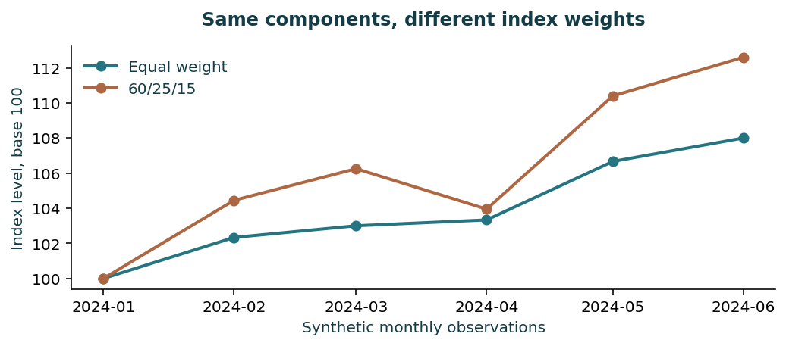

# IndexFoundry

IndexFoundry makes the construction rules of an equity index visible. Start with US or European equities, choose a sector or investment style, then compare the resulting index with the S&P 500 or the STOXX Europe 600.

## Explore a construction rule

Filter the universe by sector or subsector, or build a momentum or financial-strength index. Compare its path with the reference benchmark, then inspect annualised return, volatility, Sharpe ratio and maximum drawdown. The app can export the analysis and charts.

## How much do the weights matter?

I ran the same three fictional price series through the application's index calculation. The equal-weight index ended at **108.00**. Giving the first company a 60 percent weight raised the final index to **112.60**. Both series start at 100. Run `python example.py` to repeat the calculation offline. [Example](example.py) · [Index calculation](index_math.py)



## Read the last index level by hand

| Company | Start | Finish | Weight in the concentrated index |
| --- | ---: | ---: | ---: |
| Firm A | 100 | 120 | 60% |
| Firm B | 100 | 100 | 25% |
| Firm C | 100 | 104 | 15% |

### Rebase each share, then weight it

I put each constituent on the same scale before combining them. Write $P_{i,0}$ for its opening price, $P_{i,t}$ for its price at date $t$ and $w_{i,0}$ for its opening share of the basket. I hold the same shares through all six monthly observations in the example.

```math
X_{i,t}=\frac{P_{i,t}}{P_{i,0}},\qquad I_t=100\sum_i w_{i,0}X_{i,t}
```

Firm A rises 20%, B finishes flat and C rises 4%. In the concentrated index their contributions are **12.0, 0.0 and 0.6 index points**. This gives **112.60**, compared with **108.00** for equal opening weights. The weights are joined to prices by ticker, so changing the order of the price columns gives the same index.

### Why a 60% opening weight does not stay at 60%

As prices move, each constituent's share of the basket changes. The value of Firm A's initial allocation grows from 60 to 72 units. Its share of the final index is therefore **72/112.60 = 63.94%**.

```math
w_{i,t}=\frac{w_{i,0}X_{i,t}}{\sum_j w_{j,0}X_{j,t}}
```

The interactive example varies Firm A's opening weight and splits the balance between B and C in a 5:3 ratio. In the workbook's rebalancing routine, a new segment starts from the previous segment's last level. That lets the constituents or weights change without an artificial jump on the linking date. [Index levels and rebalancing](index_math.py) · [Three-company price paths](example.py)

In the workbook workflow, I align the trading dates, convert European prices using the matching FX series, normalise prices, then compare the constructed index with its benchmark. The workbench also supports country subsets, financial-strength and momentum selections, rebalancing, and chart exports. Each session generates its own report archive.

[Weighting and rebasing](index_math.py) · [Workbook input contract](workbook.py) · [Sector and style studies](workbench.py) · [Report archive](reports.py)

## Run locally

```sh
python -m pip install -r requirements.txt
python -m streamlit run Interactive_Financial_Index_Builder.py
```

The opening **Weighting study** needs no workbook or network connection. For **Workbook analysis**, select a local eight-sheet Excel file or place `Data projet indices python.xlsx` in the working directory. The app reads it locally. [Required sheet names](workbook.py)

Tom Bussard
