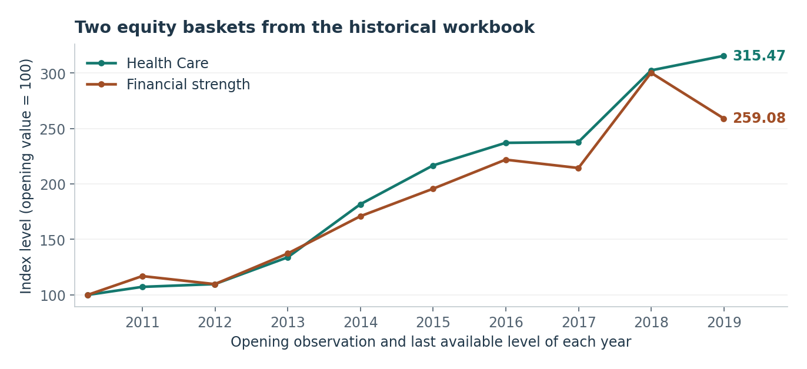

# IndexFoundry

IndexFoundry makes the construction rules of an equity index visible. Start with US or European equities, choose a sector or investment style, then compare the resulting index with the S&P 500 or the STOXX Europe 600.

## Index workbench

The opening experiment lets me move one starting weight, see both index paths change and download their levels as CSV. With an eight-sheet market workbook, the second view goes from raw US and European price histories to a sector, country or style index. I can choose a date range, inspect exclusions for missing prices, match EUR/USD by date, compare against the S&P 500 or STOXX Europe 600, review rebalancing and export the session's charts and tables as an archive.

The financial-strength view lets me change four fundamental weights and the number of names retained. The momentum view lets me change the lookback, selected percentage and weighting rule. The example below runs from the public three-stock fixture. The workbook studies take the user's own fundamentals, FX and market histories. [Interactive starting point](Interactive_Financial_Index_Builder.py) · [Workbook schema](workbook.py) · [Market and style calculations](workbench.py)

## Explore a construction rule

Filter the universe by sector or subsector, or build a momentum or financial-strength index. Compare its path with the reference benchmark, then inspect annualised return, volatility, Sharpe ratio and maximum drawdown. The app can export the analysis and charts.

## How much do the weights matter?

I ran the same three fictional price series through the application's index calculation. The equal-weight index ended at **108.00**. Giving the first company a 60 percent weight raised the final index to **112.60**. Both series start at 100. Run `python example.py` to repeat the calculation offline. [Example](example.py) · [Index calculation](index_math.py)


## Read the last index level by hand

| Company | Start | Finish | Weight in the concentrated index |
| --- | ---: | ---: | ---: |
| Firm A | 100 | 120 | 60% |
| Firm B | 100 | 100 | 25% |
| Firm C | 100 | 104 | 15% |

### Rebase each share, then weight it

I put each constituent on the same scale before combining them. Write $P_{i,0}$ for its opening price, $P_{i,t}$ for its price at date $t$ and $w_{i,0}$ for its opening share of the basket. I hold the same shares through all six monthly observations in the example.

```math
X_{i,t}=\frac{P_{i,t}}{P_{i,0}},\qquad I_t=100\sum_i w_{i,0}X_{i,t}
```

Firm A rises 20%, B finishes flat and C rises 4%. In the concentrated index their contributions are **12.0, 0.0 and 0.6 index points**. This gives **112.60**, compared with **108.00** for equal opening weights. The weights are joined to prices by ticker, so changing the order of the price columns gives the same index.

### Why a 60% opening weight does not stay at 60%

As prices move, each constituent's share of the basket changes. The value of Firm A's initial allocation grows from 60 to 72 units. Its share of the final index is therefore **72/112.60 = 63.94%**.

```math
w_{i,t}=\frac{w_{i,0}X_{i,t}}{\sum_j w_{j,0}X_{j,t}}
```

The interactive example varies Firm A's opening weight and splits the balance between B and C in a 5:3 ratio. In the workbook's rebalancing routine, a new segment starts from the previous segment's last level. That lets the constituents or weights change without an artificial jump on the linking date. [Index levels and rebalancing](index_math.py) · [Three-company price paths](example.py)

In the workbook workflow, I align the trading dates, convert European prices using the matching FX series, normalise prices, then compare the constructed index with its benchmark. The workbench also supports country subsets, financial-strength and momentum selections, rebalancing, and chart exports. Each session generates its own report archive.

[Weighting and rebasing](index_math.py) · [Workbook input contract](workbook.py) · [Sector and style studies](workbench.py) · [Report archive](reports.py)

## Currencies, styles and a rebalance

For the sector index I check price coverage for each ticker and inspect long missing stretches before filling the surviving series. European prices are converted to USD with the matching date's EUR/USD quote. A currency move therefore contributes to the USD return even when the local share price is unchanged.

```math
P^{\rm USD}_{i,t}=P^{\rm EUR}_{i,t}X_t,\qquad
1+r^{\rm USD}_{i,t}=(1+r^{\rm EUR}_{i,t})(1+r^{\rm FX}_t).
```

The financial-strength score uses min-max scaling on four features of the eligible snapshot. With $n(x)=(x-\min x)/(\max x-\min x)$ and default weights, the score is

```math
s_i=0.25\,n(P/B)_i+0.25\,n(1/(P/E))_i+0.30\,n(\mathrm{cap})_i+0.20\,n(\mathrm{yield})_i .
```

Here dividend yield and book multiple enter in their original directions. The earnings multiple enters through its reciprocal. After ranking and selecting, the score-weighted basket uses $s_i/\sum_j s_j$. The momentum view instead compounds daily returns over up to $21m$ observations for a lookback of $m$ months. It offers equal or momentum-score weights for the selected names.

```math
M_{i,t}=\prod_{j=0}^{L-1}(1+r_{i,t-j})-1,\qquad L\le21m.
```

The momentum page ranks at the final observation of the selected window and plots the chosen basket over that history. It is a retrospective comparison. A walk-forward performance estimate would require selecting with information available at each earlier decision date.

### Link two baskets on the same public price data

I ran the 60/25/15 basket to its third observation, which ends at **106.25**. I then supplied new relative capitalisations of 20/60/20 and rebased the remaining three observations at their first prices. For a new segment starting at $\tau$ the routine links the series by

```math
I_t=I_{\rm previous\ close}\sum_i w_{i,\tau}\frac{P_{i,t}}{P_{i,\tau}}.
```

| Construction | First new point | Next point | Final level |
| --- | ---: | ---: | ---: |
| Retain the 60/25/15 opening basket | 103.95 | 110.40 | 112.60 |
| Link a new 20/60/20 basket | 106.25 | 108.27 | 108.24 |

The first new point carries the old close under the function's linking convention. The subsequent moves reflect the new weights. Firm B, which finishes close to its starting price, now drives 60% of the new segment. Run `python example.py` to print all three paths. [Public prices and linked basket](example.py) · [Rebasing, cap weights and linking](index_math.py) · [Chart archive](reports.py)

## Results from the historical workbook

I also ran the full Streamlit workbench on the original US and European equity workbook. The window runs from **1 April 2010 to 28 December 2018**, with 2,168 dates in the sector and financial-strength outputs. I kept all countries for the Health Care sector, used the default fundamental weights and top ten names, and used six months, the top 30% and score weights for the momentum view.

| Workbook study | Opening level | Final level |
| --- | ---: | ---: |
| Health Care sector, capitalisation weights | 100.00 | 315.47 |
| Financial strength, ten score-weighted names | 100.00 | 259.08 |
| Momentum, six-month ranking | 100.00 | 317.89 |



The financial-strength basket had **16.12% annualised volatility** and a **24.53% maximum drawdown** on its daily path. The corresponding figures for momentum were **13.53%** and **19.36%**. The sector and fundamental baskets use a 2018 fundamentals snapshot over the earlier price history, and the momentum selection uses the end of its window. These levels describe how the selected baskets behaved retrospectively. The downloadable CSV contains the aggregate points plotted above. [Opening and year-end index levels](results/workbook-index-levels.csv) · [Workbench controls and calculations](workbench.py)

## Run locally

```sh
python -m pip install -r requirements.txt
python -m streamlit run Interactive_Financial_Index_Builder.py
```

The opening **Weighting study** needs no workbook or network connection. For **Workbook analysis**, select a local eight-sheet Excel file or place `Data projet indices python.xlsx` in the working directory. The app reads it locally. [Required sheet names](workbook.py)

Tom Bussard
